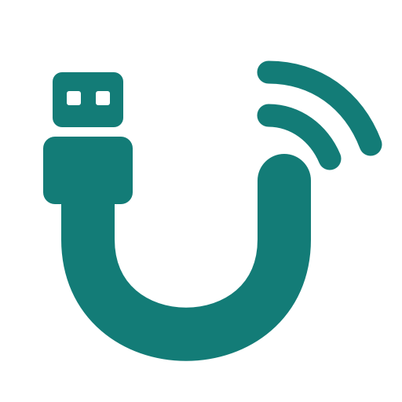

<p align="center"></p>
<h1 align="center">UTA · USB to Air</h1>
<p align="center">USB 插在身边，开发工具运行在云端。</p>

UTA 将 Mac 上选定的真实 USB 设备，通过 SSH 接入远程 Linux 服务器。
服务器上的工具直接使用虚拟 USB 和对应串口，固件与编译环境留在服务器，
无需来回下载文件到本机烧录。

**当前状态：0.1 实验原型，build 15（Preview 3）。** 已完成部分开发板实机验证，尚未完成通用 USB
兼容性验收。当前支持 **macOS Apple Silicon → Linux**，没有 Windows 或 iOS 客户端。
提供预编译安装包与源码。预览版已签名，但尚未经过 Apple 公证。

## 下载 Mac 预览版

**[下载 DMG 安装包](https://github.com/TailorLiuuu/UTA/releases/download/v0.1.0-preview.3/UTA-0.1.0-macOS-arm64.dmg)** ·
[Release 与 ZIP 备用包](https://github.com/TailorLiuuu/UTA/releases/tag/v0.1.0-preview.3) ·
[首次安装指南](docs/INSTALL-macOS.md)

适用于 Apple Silicon / macOS 26，需另行安装 Python 3.9+。打开 DMG，将 UTA 拖入
Applications，然后从“应用程序”启动。未公证的预览版可能需要在“隐私与安全性”中允许打开；
USB 接管还需单独完成系统授权。首次安装、升级和卸载步骤见安装指南。

## 能做什么

- **管理多台服务器**：从 `~/.ssh/config` 导入别名，沿用密钥、端口和跳板机配置，修改显示备注。
- **按设备分配**：选择 USB 接入哪台服务器；不同设备可分配到不同服务器，同一设备独占一台服务器。
- **桌面界面 + CLI**：查看连接进度、云端串口/USB 节点、占用诊断和日志；CLI 输出 JSON，方便脚本与开发代理调用。
- **SSH 加密传输**：使用 loopback 监听和 SSH 反向隧道，无需在公网开放 USB/IP 的 3240 端口。
- **本机授权接管**：需要接管系统驱动占用的接口时，使用用户批准的 macOS 辅助服务，界面和 SSH 保持普通用户权限。
- **断开清理与有限重连**：自动释放失效的云端会话；按原 USB 插口及用户配置的设备标识重连。

UTA 的职责是 **USB 接入与传输**。它不包含 ESP32、ML307H、BK7258 等芯片的烧录协议，
不解析固件、进入下载模式或执行固件验证。具体设备继续使用其原厂或项目工具。

## 工作方式

```text
Mac：开发板 / USB 设备
        │
        ▼
UTA App / CLI ── 本地后台控制器 ── USB/IP 导出器
                                      │
                                SSH 加密隧道
                                      │
                                      ▼
Linux：uta-server ── vhci_hcd ── /dev/tty* 或 /dev/bus/usb/*
                                      │
                                原有驱动与开发工具
```

USB 请求由远端发起，经 UTA 到达本地设备。服务端没有实体 USB 接口也可以使用，
但其 Linux 内核必须支持 `vhci_hcd`，并允许相应的管理员操作。

## 环境要求

| 位置 | 要求 |
| --- | --- |
| Mac 运行端 | Apple Silicon、macOS 26、Python 3.9+、系统 OpenSSH |
| Mac 构建端 | Xcode 工具链及 macOS SDK、CMake 3.22+、pkg-config、libusb |
| Linux 服务端 | Python 3.9+、OpenSSH、启用 `CONFIG_USBIP_VHCI_HCD` 的内核 |
| 权限 | Mac 接管辅助服务需系统批准；Linux 挂载需 root 或管理员配置的受限 sudo 权限 |
| 网络 | Mac 能通过 SSH 登录服务器；服务器允许 remote TCP forwarding |

SSH 服务端的 `GatewayPorts` 应为 `no` 或 `clientspecified`。普通受限容器不一定能使用
宿主机 USB/IP 内核模块。旧版 macOS、Intel Mac、其他 USB 类型尚未完成验证。
Linux 路由代理仅使用 Python 标准库，不依赖 Node.js。

## 从源码构建

```bash
git clone https://github.com/TailorLiuuu/UTA.git
cd UTA

# 已安装 Homebrew 时，可用它安装构建依赖
brew install cmake pkg-config libusb python

# 查看本机可用的签名证书
security find-identity -v -p codesigning

# 替换为自己的有效 Developer ID Application 签名身份
UTA_SIGN_IDENTITY="Developer ID Application: YOUR NAME (TEAM_ID)" bash scripts/build.sh
```

构建脚本不会下载源码依赖；USB/IP、Asio、spdlog 源码已包含在 `vendor/`。
App 与接管辅助服务使用同一签名身份。默认本地构建不添加可信时间戳；
发布构建设置 `UTA_SIGN_TIMESTAMP=secure`，需要连接 Apple 时间戳服务。脚本不执行公证。

仅做界面、协议开发时可以使用临时签名：

```bash
UTA_ALLOW_ADHOC=1 bash scripts/build.sh
```

临时签名不保证 macOS 接管辅助服务能启动，不能替代真实 USB 接管验证。

| 构建输出 | 用途 |
| --- | --- |
| `dist/UTA-0.1.0-macOS-arm64.zip` | 包含 App、本地 CLI 启动器、服务器脚本及测试指南的分发包 |
| `dist/UTA.app` | 桌面应用 |
| `dist/uta` | 调用旁边 App 内本地 CLI 的启动器 |
| `dist/uta-server` | 可单文件安装的 Linux CLI |
| `dist/uta-usb-io`、`dist/uta-usb-transport.mjs` | 可选的通用异步 USB 接口，供外部应用主动接入 |

建议从 ZIP 解压安装 App；构建在临时目录完成签名和归档，避免同步目录元数据影响签名。
构建后可运行 `UTA_SIGN_IDENTITY="你的签名身份" bash scripts/package-macos.sh` 制作 DMG。

## 快速开始

1. 将构建出的 App 安装到 `/Applications/UTA.app`，打开 UTA。
2. 先在终端 `ssh YOUR_SERVER_ALIAS`，核对主机指纹，确认密钥或 SSH Agent 登录正常。
3. 点击“从 SSH 配置导入”，选择服务器；也可以手动添加、修改备注。
4. 选择服务器，点击“安装云端代理”。已安装时显示状态；没有自动安装权限时使用“手动安装”。
5. 如设备需要系统驱动接管，在 App 启用 USB 接管，并按 macOS 提示批准辅助服务。
6. 插入设备，选择目标服务器，点击“接入”。等状态显示 **云端已挂载**，再使用显示的云端端口。

云端的 `/dev/ttyACM0` 等路径属于 **服务器**。接管期间设备可能从 Mac 的本地应用中消失。
关闭窗口不会停止后台传输；“断开”释放设备，停止后台服务则关闭所有连接。
完整权限、安装和排错步骤见 [测试与使用指南](docs/TESTING.md)。

### 手动安装 Linux 代理

以下上传命令在 Mac 执行：

```bash
scp dist/uta-server YOUR_SERVER_ALIAS:~/uta-server.py
ssh -t YOUR_SERVER_ALIAS
```

登录服务器后执行：

```bash
sudo install -o root -g root -m 755 ~/uta-server.py /usr/local/bin/uta-server
sudo modprobe vhci_hcd
sudo /usr/local/bin/uta-server doctor
```

自动接入需要非交互权限；非 root 账号的 sudo 配置由管理员完成，UTA 不会自行修改 sudoers。
缺少 `vhci_hcd` 时应先解决内核模块问题，代理已安装不等于 USB 环境已就绪。

## CLI 与自动化

本地 CLI 和桌面界面使用同一后台状态。安装 App 后，在 Mac 终端执行：

```bash
UTA="/Applications/UTA.app/Contents/Resources/uta"

"$UTA" server discover
"$UTA" server import YOUR_SERVER_ALIAS
"$UTA" server list
"$UTA" server check SERVER_ID
"$UTA" server install SERVER_ID
"$UTA" devices
"$UTA" connect --device BUSID --server SERVER_ID --reconnect auto
"$UTA" status
"$UTA" diagnose --device BUSID
"$UTA" disconnect --device BUSID
```

将 `SERVER_ID` 和 `BUSID` 替换为查询结果。`connect`、`disconnect`、`check`、`install`
返回 `started: true` 只表示任务已接受；需要继续查询 `status`，确认 `attached` 或具体错误。
`uta stop` 停止本地后台并释放连接。

远程开发会话调用服务器 CLI：

```bash
sudo -n uta-server list
sudo -n uta-server status --session SESSION_ID
```

响应包含 `state`、`session`、`route_id`、来源 `busid`、`vidpid` 和 `nodes`。
按目标设备身份选择节点，然后调用项目已有的烧录/调试工具。不要默认选择第一个串口。
`uta-server` 提供 `doctor`、`list`、`status`、`attach`、`detach`，挂载通常由 Mac 控制器管理；
没有内置 `flash` 命令。

## 模式切换与自动重连

已选设备断开后，UTA 最多等待 120 秒、尝试 3 次，先清理旧会话，再接回原服务器。
默认只接受原插口、原 VID:PID；有序列号时还会校验身份。

若设备进入另一模式会改变 VID:PID，卡片会提示“是否仍是刚才的设备？”。
确认后接回原服务器，并记住此模式；选择“不是，留在本机”会取消这次等待。
通常不必手填标识。高级设置仍可查看、编辑或清除记忆；CLI 也可显式指定（可重复）：

```bash
"$UTA" connect --device BUSID --server SERVER_ID \
  --reconnect auto --reconnect-id 1234:5678
```

`1234:5678` 是示例，应替换为设备实际标识。CLI 参数限定当前连接；界面确认或高级设置保存的记忆按原服务器、插口和原设备身份保存。
重新启动后再次手动接入原设备可复用，不会因保存记忆就自动接管设备。
手动断开、关闭重连会取消等待；控制器重启不恢复接管意图。
无序列号设备无法区分同口替换的同型号硬件，等待期间不要换板。

**USB 重连不等于烧录续传。** 重枚举后端口可能改变，原工具需要关闭旧句柄并找到新设备。
UTA 不会重放结果未知的写入命令，也不会自动继续中断的烧录。

## 兼容性与速度

| 场景 | 验证情况 |
| --- | --- |
| ESP32-S3 USB JTAG/Serial | 云端识别、ROM 模式烧录、独立镜像校验及基本启动已验证；见[实测记录](docs/ESP32-FLASH-2026-10-21.md) |
| ESP32 默认 stub 大块读取 | 曾出现数据损坏错误，尚未解决；不能宣称默认高速模式可靠 |
| ML307H | 已通过独立项目工具完成烧录及运行验证；协议不在本仓库中 |
| BK7258、其他 USB 设备 | 尚未完成实机验收，不能从以上结果外推 |
| 等时音视频、USB 存储、复杂 Hub 拓扑 | 尚未完成兼容性验收 |

性能取决于网络往返延迟、工具的 USB 请求方式、数据块大小与驱动。
逐小包同步等待的工具在远程链路上可能明显变慢；仅升级 UTA 不会让它自动获得高速烧录能力。
可选的[异步 USB 接口](docs/USB-TRANSACTIONS.md)需要外部工具主动使用，不能透明改变第三方烧录协议。

云端仍需设备对应的驱动和工具；Windows 专用烧录器不能直接在 Linux 上运行。
同一设备只能被一个目标独占使用。本工具不是为互不信任租户设计的安全隔离系统。

## App 内更新

侧栏和 UTA 菜单提供「检查更新」。开启「自动检查更新」后会提示新版，
点击下载安装，再重启即可。USB 正在使用、等待重连或清理时会阻止更新。
Preview 2 及更早版本需要先手动安装一次新版。更新机制与发布步骤见 [UPDATES.md](docs/UPDATES.md)。

## 开发与测试

构建原生测试夹具后运行：

```bash
cmake -S native -B build/native -DCMAKE_BUILD_TYPE=Release
cmake --build build/native -j 6
python3 -B -m unittest discover -s tests -v
node --test tests/test_usb_adapter.mjs
```

Node.js 18+ 仅用于可选适配器及其测试；基础透传不需要 Node。
测试包含本地 socket、原生 USB/IP 合成设备、模拟 sysfs 和控制器逻辑；环境需允许本地监听。
Build 15 通过 75 个 Python 测试和 3 个 Node 测试。构建与自动化测试不能替代实机验收。

```text
macos/    SwiftUI 界面、系统授权与 XPC 辅助服务
python/   本地控制器、JSON CLI、Linux 代理与通用 USB worker
native/   USB/IP 导出器与原生构建入口
linux/    可选 Node USB 传输适配器
scripts/  构建、图标生成与 CLI 启动器
tests/    自动化测试及原生测试夹具
vendor/   第三方源码与许可证
docs/     使用指南、验证记录与变更说明
```

配置与日志默认位于 `~/Library/Application Support/UTA/`，可用 `UTA_HOME` 指定测试目录。
不要提交服务器配置、SSH 密钥、固件、设备备份或含设备身份的原始日志。

## 文档与第三方许可

- [安装、权限、CLI 与排错](docs/TESTING.md)
- [通用 USB 事务接口](docs/USB-TRANSACTIONS.md)
- [验证记录](docs/VERIFICATION.md) · [变更记录](docs/CHANGES.md)
- [第三方来源与许可证](THIRD_PARTY.md)

UTA 使用 USB/IP、usbipdcpp、libusb 等公开协议与组件，不包含 VirtualHere 等产品的专有代码。
第三方文件按各自许可证提供。UTA 自有代码目前尚未选择统一开源许可证；源码公开不等于已授予任意再分发授权。
